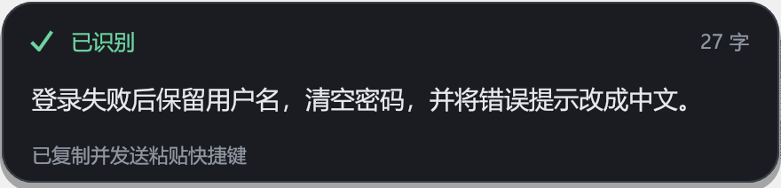

<p align="center"></p>
<h1 align="center">Vibe Voice Lite</h1>
<p align="center">在 Windows 输入框里按住右 Ctrl 说话，松手即可转写。开发需求可以交给 AI 整理，也可以逐轮访谈。</p>
<p align="center"><strong><a href="https://github.com/UtenKekkoDev/vibe-voice-lite/releases/download/v0.2.0-preview.3/vibe-voice-lite-windows-x64.zip">下载 Windows x64 · preview.3</a></strong> &nbsp;·&nbsp; <a href="https://github.com/UtenKekkoDev/vibe-voice-lite/releases/tag/v0.2.0-preview.3">版本说明</a> &nbsp;·&nbsp; <a href="README.en.md">English</a></p>

<p align="center"></p>

## 第一次使用

1. 下载并解压整个 Windows ZIP，启动 `vibe-voice-lite.exe`。支持 Windows 10/11 x64，需要麦克风和 [Microsoft Visual C++ x64 运行库](https://aka.ms/vs/17/release/vc_redist.x64.exe)。预览版尚未签名。
2. 在首次打开的设置中选择识别方式。本地使用 [SenseVoice INT8 模型](docs/MODELS.zh-CN.md)，也可以填写在线 Qwen-ASR Realtime 的配置。点击「重新检查设备和识别」查看状态。
3. 点击目标输入框，按住 **右 Ctrl** 说一句话，再松开。托盘可以切换模式、修改快捷键或关闭自动粘贴。需要取回最近一次完整正文时，选择 **复制上次结果**。

## 三种模式

| 模式 | 适合什么时候用 | 松开按键后 |
| --- | --- | --- |
| 1 · 语音听写 | 写消息、记笔记 | 直接转写，也可开启 AI 润色 |
| 2 · 开发指令 | 向开发工具描述改动 | 提取目标、约束和待定项，重要歧义可以继续回答 |
| 3 · 需求问答 | 目标已有雏形，细节还需讨论 | 每轮问一个重点，结束时输出「已确定」和「待定」 |

**切换模式**　按住右 Ctrl，单独说“第二”或“切换第二个”，松开即切到开发指令。想先听有哪些选项，可以说“切换模式”“Switch mode”或“Switch type”，再按键回答编号或名称。启用 Serena 时会听到切换回执。说“取消”或按 Esc 可以返回刚才的访谈。访谈中如要回答问题里的第二个选项，可以说“我选第二个”。

### 需求问答口令

访谈可以从“我想改一下登录失败后的提示”开始。按住说话键会打断当前播报，松开后提交回答。

| 你说或按下 | 程序会怎样处理 |
| --- | --- |
| “直接输入”或“直出” | 输出最近一段自己的识别原文并结束本轮，保留需求问答模式。若在同一次录音末尾说“正文，这句直接输入”，仅输出此次正文。 |
| “这个先待定” | 记下当前问题，允许之后再补充决定 |
| “OK，就这样”“先整理到这里”或“停止” | 结束访谈并生成总结。看到“可以整理了”时也可以继续说 |
| “取消这次整理”、等待回答时按 Esc | 取消本次对话。切换模式或退出程序也会取消访谈 |

访谈中可以自然收尾，例如“我说完了，就麻烦你整理一下”。总结生成后，启用 Serena 时会听到一声完成回执。

## 配置 AI 与语音

语音听写可以只使用本地识别。开发指令和访谈需要 DeepSeek、OpenAI、Ollama 或兼容 Chat Completions 的接口、模型名及相应凭据。远程服务使用 HTTPS，本机回环地址可以使用 HTTP。

需要朗读提问时，可另装 **Qwen3-TTS 1.7B CustomVoice / Serena**。当前后端使用 NVIDIA CUDA，模型权重、Python 和 CUDA 环境均需另行安装。Serena 会朗读澄清问题、访谈问题、模式选择提示、切换回执和访谈完成回执。预热后模型驻留，重启语音或退出程序时释放。[本地 TTS 配置指南](docs/TTS.md)

### Serena 首播实测（preview.1 与 preview.2）

RTX 5080 上用同一问句交替测试两个版本，各重启语音后台三次。下表为从提交播报请求到设备首次输出非静音音频的中位数。

| 场景 | preview.1 | preview.2 |
| --- | ---: | ---: |
| 后台刚启动 | 10.36 秒 | **8.64 秒** |
| 后台已就绪 | 307 毫秒 | **298 毫秒** |

测试句的 107,520 个音频采样和六个流式分块逐一一致。设置里的「本次运行耗时」可查看最近八轮从松键到识别、AI 响应和播报首音的累计时间。

## 隐私与投递

- 本地识别与 TTS 在设备上运行。启用在线识别会向服务商发送音频；启用 AI 会向所选服务发送转写、术语表和历轮问答。
- 设置位于 `%LOCALAPPDATA%/VibeVoiceLite/settings.json`。AI 密钥由 Windows DPAPI 加密并绑定当前用户和接口，Qwen-ASR 密钥仅在当前会话保存。录音与转写不会写入设置。
- 自动粘贴会检查前台窗口、焦点和标题。部分网页复用这些信息，管理员窗口也可能拦截快捷键。可从托盘取回最近一次完整正文；退出时清除内存副本，已复制的内容由 Windows 剪贴板管理。
- 发生 AI 整理失败时，卡片会显示原因。本机生命周期日志记录输入模式、是否收到完整响应及错误原因。单独开启的调试日志可能包含文字。本机 TTS 路径保存在 `tts/runtime.json`。分享问题报告前请检查附件。[安全说明](SECURITY.md)

## 从源码构建

准备 Rust stable、Visual Studio C++ Build Tools 和 Windows SDK，在能找到 `rc.exe` 的 **Developer PowerShell for VS** 中运行：

```powershell
cargo build --locked --release --bin vibe-voice-lite
./scripts/package.ps1
```

首次构建会下载依赖和 ONNX Runtime。打包脚本生成 Windows ZIP 与 SHA-256 校验文件。格式检查、测试、真机验证与发布流程见[贡献指南](CONTRIBUTING.md)。

本项目基于 [vibe-coding-voice](https://github.com/UtenKekkoDev/vibe-coding-voice) 开发。[MIT 许可证](LICENSE) · [第三方声明](THIRD_PARTY_NOTICES.md)
